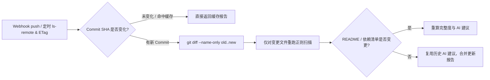

<div align="center">

# 🛡️ Repo Health Check

<h3>Git 仓库接入前自动化体检工作台</h3>

[](https://github.com/cowcool-niushuai/repo-health-check/stargazers)
[](https://github.com/cowcool-niushuai/repo-health-check/commits/main)


[快速开始](#-快速开始) · [核心能力](#-核心能力) · [评分模型](#-评分体系) · [更新跟踪设计](#-更新跟踪设计说明) · [AI 使用记录](./AI_USAGE.md)

</div>

---

* 输入任意公开 Git 仓库链接（支持 GitHub / GitLab / Gitee HTTPS 地址，自动剥离 `/tree/` 或 `/blob/` 网页路径），即可在数秒内完成接入前自动化体检。
* 自动识别 **工程完整度**、**Windows 专用脚本**、**硬编码本地路径** 与 **密钥敏感信息泄露** 四大维度风险，返回前强制对密钥中间打码脱敏。
* 前端采用极简亮色扁平排版 + **Apache ECharts** 仪表盘与四维度雷达图，支持关键词搜索、维度联动筛选与一键导出 Markdown 报告。
* 内置 **AI 接入建议模块**：支持通过页面或环境变量接入 OpenAI / DeepSeek 兼容大模型生成独立 `ai_score` 与整改建议，未配置 Key 或网络异常时自动优雅降级为规则引擎。

> 注：本项目为全栈一体化轻量化交付（FastAPI 后端 + 单页静态前端），无需额外 Node 构建步骤，一行命令即可启动。

---

## 📌 为什么需要接入体检？

在将外部开源项目或历史遗留仓库接入内部平台、CI/CD 流水线或 Linux 服务器前，常常会遇到以下隐性阻塞：

- **跑不起来**：缺少 `README`、依赖清单（`package.json` / `requirements.txt` / `go.mod`）或标准启动脚本；
- **平台锁死**：仓库充斥 `.bat` / `.ps1` 等 Windows 专用脚本且无跨平台替代方案；
- **换机报错**：源码硬编码了 `C:\Users\...`、`/Users/...` 等个人本机绝对路径；
- **安全隐患**：`.env`、私钥文件或 `sk-` / `AKID` / `AKIA` / `ghp_` / `Bearer` 等凭证被直接提交入库。

**Repo Health Check** 在不执行目标仓库任何代码的前提下，通过浅克隆（`git clone --depth 1`）+ 多维静态扫描，提前给出量化的**接入就绪度评分**与**主要风险清单**。

---

## ✨ 核心能力

| 检查维度 | 识别内容 | 降噪与安全策略 |
| :--- | :--- | :--- |
| **📦 工程完整度** | 根目录 `README*`（及安装/运行/环境章节）、主流依赖清单（`package.json`、`requirements.txt`、`pyproject.toml`、`go.mod`、`Cargo.toml`、`pom.xml` 等）、启动配置（`Dockerfile`、`docker-compose.yml`、`Makefile`、`start.sh`、`package.json scripts`） | 自动排除 `tests/`、`examples/` 等测试示例子目录的依赖文件；多 README 章节布尔合并 |
| **🪟 Windows 专用脚本** | `.bat` / `.cmd` / `.ps1` / `.vbs` 文件，以及 `package.json` 中的 `cmd /c`、`powershell`、`set VAR=` 等命令 | 同目录已有 `Makefile` / `.sh` 跨平台替代（如 Sphinx `docs/make.bat`）时自动忽略，避免误报 |
| **📁 硬编码路径** | Windows 盘符路径（`C:\...`、`C:/...`）与 Unix 个人/用户路径（`/Users/...`、`/home/...`、`/root/...`） | 跳过纯注释行、文档示例与测试目录；`/opt/`、`/var/www/` 等系统探测路径标为 `LOW` 不扣分；忽略 `Dockerfile` 容器路径 |
| **🔐 密钥与敏感信息** | `.env` / `.pem` / `.key` / `id_rsa` 直接入库，以及 `sk-`、`AKID`、`AKIA`、`ghp_`、`Bearer`、`PRIVATE KEY` 等凭证 | 过滤 `example`/`placeholder`/`your_` 占位符；先对整行打码（`****`）再截断，杜绝明文二次泄露 |

---

## 🧭 评分体系

总分 **100 分制**，按四个维度加权扣分，输出 **A / B / C / D** 评级与逐条扣分明细：

- **A 级（85–100）**：工程规范良好，可直接接入试跑；
- **B 级（70–84）**：基本就绪，按风险清单微调即可；
- **C 级（50–69）**：存在明显接入阻塞或安全隐患；
- **D 级（0–49）**：高风险仓库，需整改后再接入。

> **安全一票封顶机制**：只要在非测试目录检测到高危密钥/敏感文件入库，接入就绪度总分**强制封顶 59 分**。

---

## 🚀 快速开始

### 方式一：本地 Python 启动
```bash
git clone https://github.com/cowcool-niushuai/repo-health-check.git
cd repo-health-check
pip install -r requirements.txt
uvicorn app.main:app --host 0.0.0.0 --port 8000
```
启动后浏览器访问：`http://localhost:8000`

### 方式二：Docker Compose 一键启动
```bash
docker compose up --build
```

### 可选：开启 AI 大模型评分与建议
可在网页输入框下方展开 **「可选：配置 AI 模型参数」** 在线填写，或通过环境变量配置（支持 OpenAI / DeepSeek 等任意兼容接口）：
```bash
export LLM_API_KEY="your-api-key"
export LLM_BASE_URL="https://api.deepseek.com/v1"
export LLM_MODEL="deepseek-chat"
```

### 运行测试
```bash
pytest -v
```

---

## 🗂️ 项目结构

```text
repo-health-check/
├── app/
│   ├── main.py           # FastAPI 入口、异步线程池调度与路由定义
│   ├── models.py         # Pydantic 请求/响应数据模型
│   ├── git_fetcher.py    # URL 规范化、DNS/SSRF 防护与浅克隆（含 LFS 跳过）
│   ├── scanner.py        # 四大维度静态扫描引擎、降噪去重与密钥脱敏
│   ├── scorer.py         # 可解释 0-100 评分模型与高危封顶规则
│   ├── ai_advisor.py     # LLM 接入建议（支持 SOCKS 代理回退与规则引擎兜底）
│   └── static/
│       └── index.html    # 扁平亮色可视化前端（Tailwind + Apache ECharts + Lucide）
├── tests/
│   ├── test_scanner.py   # 扫描器、边界脱敏、降噪去重与评分单元测试
│   └── test_api.py       # FastAPI 接口、URL 校验与 AI 降级集成测试
├── docs/
│   ├── PRD.md            # 需求文档
│   ├── 模块地图.md        # 模块依赖关系
│   ├── PROMPTS.md        # Vibe Coding 提示词记录
│   └── 错误台账.md        # 开发排障与误报调优记录
├── AI_USAGE.md           # AI 工具使用、验证方法与「AI 答错纠错」记录
├── Dockerfile
├── .dockerignore        # 排除 .venv/.git/.env，避免本地密钥被打进镜像
├── docker-compose.yml
├── pyproject.toml
└── requirements.txt
```

---

## 🔄 更新跟踪设计说明

> 本节为架构设计说明：若原仓库后续有代码更新，系统如何低成本发现更新、避免全量重算并做好溯源与兜底。



<details>
<summary><b>展开查看四项设计细节（发现更新 / 增量重算 / Commit 标注 / 限流兜底）</b></summary>
<br>

1. **如何发现更新**
   - **被动推送（实时）**：针对接入管理的仓库配置 GitHub Webhook，监听 `push` 事件，收到事件后立即入队触发复检。
   - **主动轮询（兜底）**：对未配置 Webhook 的公开仓库，后台定时执行轻量级 `git ls-remote <repo_url> HEAD` 或带 `If-None-Match`（ETag）请求头的 GitHub Commits API 检查最新 Commit SHA（`304 Not Modified` 不消耗 API 配额），仅当远端 SHA 与本地记录不一致时才触发拉取。

2. **如何避免全量重算**
   - **Commit 级结果缓存**：以 `(repo_url, commit_sha)` 作为唯一缓存键；若目标 Commit 已扫描过，直接命中缓存秒级返回历史报告。
   - **文件级增量 Diff**：当出现新 Commit（`old_sha -> new_sha`）时，通过 `git diff --name-only <old_sha> <new_sha>`（或 GitHub Compare API）提取 `Added / Modified / Deleted` 文件集合：
     - 仅对变更文件重跑正则扫描（硬编码路径、密钥、Windows 脚本），合并替换旧报告中对应文件的风险项；
     - 仅当 `README`、依赖清单或顶层目录结构发生变化时，才重新计算完整度或调用 AI 接口生成建议，大幅降低 Token 与 CPU 消耗。

3. **报告如何标注所基于的 Commit**
   - 每次扫描报告均在元数据区（`meta`）与页面顶部显著标注：
     - `branch` 与完整 40 位 `commit_sha`（界面展示 7 位短 SHA，如 `main @ 3a903b1`）；
     - `scanned_at`（UTC 扫描时间戳）；
     - 若后续轮询发现远端已有更新但尚未完成复检，界面标注「当前报告基于旧提交 `xxxxxxx`，远端已有新提交」。

4. **失败或限流时怎么兜底**
   - **API 限流处理**：服务端配置 `GITHUB_TOKEN` 将 API 配额提升至 5000 次/小时；若仍触发 `403 / 429` 限流，读取响应头 `X-RateLimit-Reset` 执行指数退避重试，并自动切换为 `git ls-remote` / `git clone --depth 1` 走 Git 协议拉取，不强依赖 REST API。
   - **拉取 / AI 失败降级**：若目标仓库临时不可达、克隆超时或 LLM 接口异常，保留并返回最近一次成功的报告快照，同时在页面顶部提示「更新检查失败，当前展示为历史快照（基于 commit `xxxxxxx`）」；AI 建议模块自动降级为本地规则引擎输出，保证核心体检报告可用。

</details>

---

## 🤖 AI 辅助开发与验证

本项目在开发与自测过程中使用了 AI Coding 助手，并针对真实开源仓库进行了多轮人工审查与纠偏，完整记录见：
- [AI_USAGE.md](./AI_USAGE.md)：AI 工具分工、验证方式与真实「AI 答错但被发现」记录
- [docs/PROMPTS.md](./docs/PROMPTS.md)：核心开发阶段提示词摘要
- [docs/错误台账.md](./docs/错误台账.md)：误报校准与缺陷修复台账
